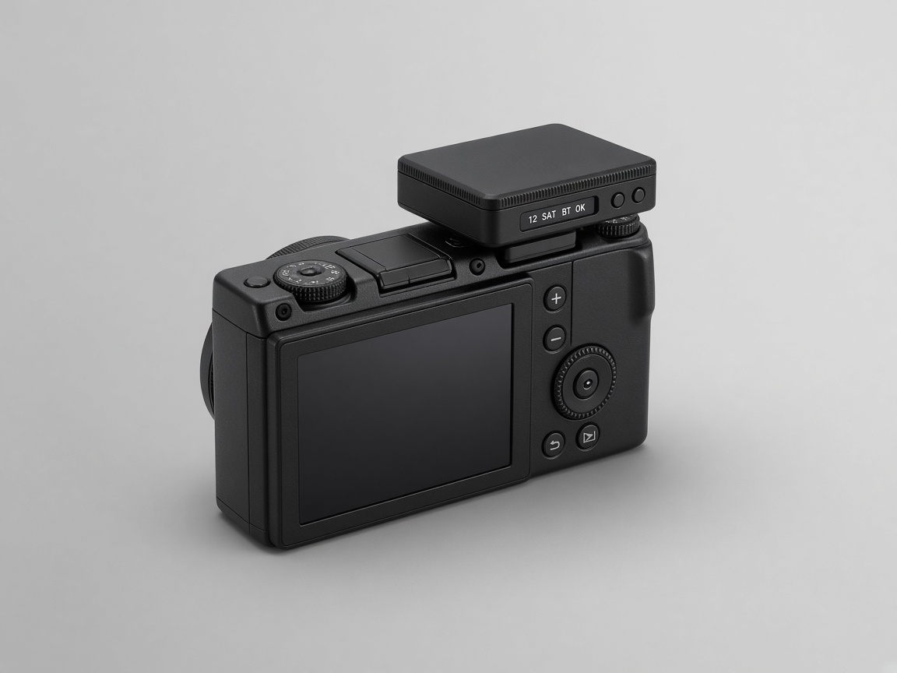
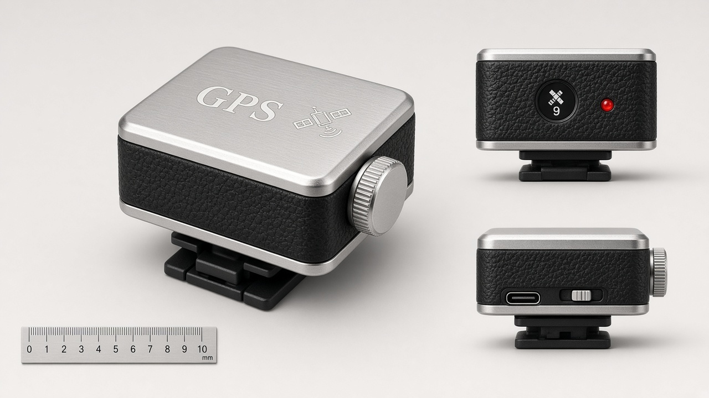
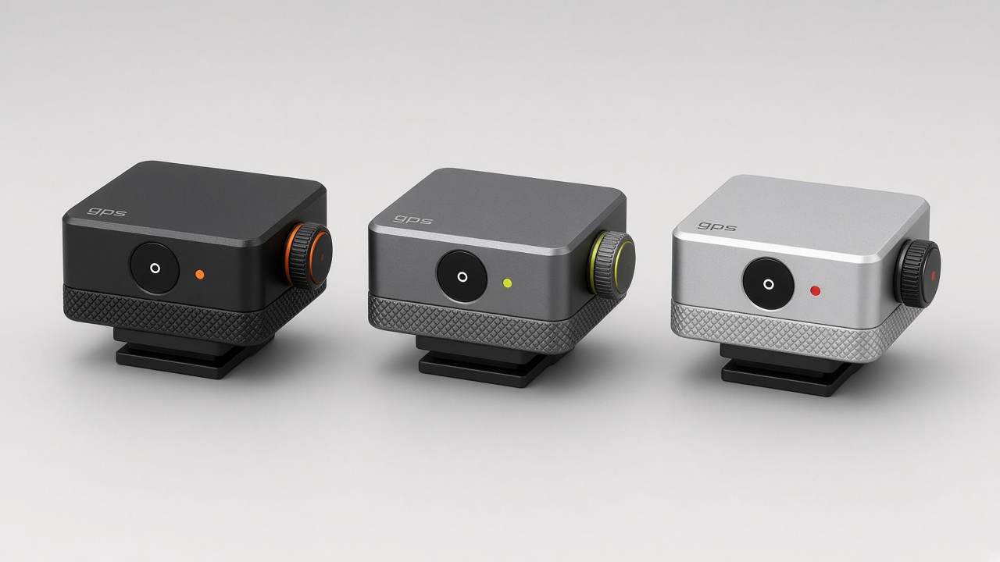
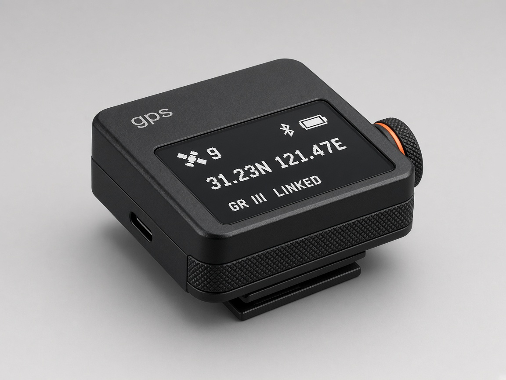

# 对话记录与决策笔记

2026-09-30 与 AI 助手讨论 RICOH GR III 二次开发的整理，按讨论顺序记录结论、依据和待验证项。

## 1. GR III 能不能二次开发

结论：可以在相机**外部**开发，改不了固件。

- 固件不开放，没有类似 CHDK 的第三方固件。
- 理光官方 Camera SDK 只支持 PENTAX 单反，不含 GR III，且 2018 年后未更新。
- USB-C 只有 MTP 传文件和 DisplayPort 输出，据了解不支持联机拍摄。
- 可用的外部接口：
  - **Wi-Fi HTTP API**：相机开热点，`http://192.168.0.1/v1`，无认证。社区整理的 OpenAPI 定义：[CursedHardware/ricoh-wireless-protocol](https://github.com/CursedHardware/ricoh-wireless-protocol)。
  - **蓝牙 BLE**：官方 Image Sync 用来唤醒、同步时间、推送位置。社区整理：[ricoh-gr-bluetooth-api](https://github.com/rock3r/ricoh-gr-bluetooth-api)。

### Wi-Fi API 能力（逆向，非官方）

- 拍摄：`POST /camera/shoot`；另有 `shoot/start|compose|cancel|finish`（用途未确认）。
- 对焦：`POST /lens/focus`（`pos=x,y`）、`/lens/focus/lock|unlock`、`PUT /params/lens`。
- 参数：`PUT /params/camera`（光圈、快门、ISO、曝光补偿、曝光模式、测光、白平衡、效果、尺寸、拍照/录像）；`PUT /params/device`（JPEG/DNG）。
- 取景：`GET /liveview`（MJPEG）。
- 照片：`GET /photos`（`limit`、`after`）、`GET /photos/{dir}/{file}`（`size=xs` 1920×1280、`view` 720×480、`thumb` 160×120，不带为原图）、`/info`、`/transfer`、`GET /transfers`；`/changes`（WebSocket 推送）。
- 设备：`GET /props`（型号、电量、过热、存储、Wi-Fi/BT/GPS 设置…）、`GET /ping`、`POST /device/wlan/finish`、`POST /device/finish`。
- GR III 用不上：`/params/lens/zoom`（G900SE 用）、第二张卡、星空追踪、渐变 ND。

## 2. radium-wang 的 GR IV 固件仓库

[ricoh-gr4-firmware-analysis-and-feature-expansion](https://github.com/radium-wang/ricoh-gr4-firmware-analysis-and-feature-expansion) **没有改固件本身**，针对的是 GR IV：

- 离线解包官方 1.11 固件包（型号字段、版本号、32 位和校验、不可降级），不能生成可安装固件。
- SD 卡根目录放两个入口文件（`DEVELOP.MOD` 为固定 10 字节）后按住 MENU 开机进入**工厂菜单**。
- 工厂菜单 `Script` 开启后，开机执行 SD 卡上的 `script/startup.ttl`（Tera Term 语言，固件内置解释器）；`filecopy` 可在 `C:`（SD 卡）和 `A:`（机内资源）之间复制，作者用它替换了关机图 `A:\Resource\Jpeg\GoodBye.jpg`。
- 约 650 条工程 shell 命令、`lcmd` 转发到机内 Linux、Debug 模式、Serial Input 等只停留在静态分析，未实机跑通任意代码。
- 对 GR III 的意义：固件解包可参考 [yeahnope/gr_unpack](https://github.com/yeahnope/gr_unpack)（原本就是为 GR III 写的）；GR III 是否有同样的工厂菜单/脚本机制未知，入口文件需要自己从固件分析。

## 3. 热靴

- GR III 没有内置闪光灯，热靴支持宾得 P-TTL（理光 GF-1、宾得 AF 系列）、X 同步触发无线引闪、外置光学取景器 GV-1/GV-2。
- 镜间快门，高速快门下闪光也能同步。
- **开发玩法**：中心触点的 X 同步信号可以作为曝光时刻的硬件时间戳（热靴转 PC 口 + 光耦 → MCU 中断），用于多传感器同步。待验证：无闪光灯时是否输出信号、延迟和抖动。
- 热靴**不能**接 GPS 数据：没有对应协议；宾得 O-GPS1 只支持宾得单反。

## 4. 给照片加位置：方案比较

| 方案 | 做法 | 结论 |
| --- | --- | --- |
| 官方 App | Image Sync 蓝牙推送手机位置，相机写 EXIF | 0 元，但依赖手机；iOS 后台受限，手机锁屏时不推送 |
| Wi-Fi 写 `gpsInfo` | ESP32 连相机热点写属性 | **放弃**：`gpsInfo` 格式未知、能否写入未验证；相机 Wi-Fi 默认关、费电；每次要手动开 |
| GPS 轨迹 + exiftool | 单独记 GPX，事后 `exiftool -geotag` | 最稳，但不是"拍完就有" |
| **BLE 写 GPS Information** | ESP32 模拟官方 App，蓝牙写位置 | **选定**：协议已公开，蓝牙开机自动重连，省电，可以"无感" |

"相机拍照时自己写 EXIF"的原理：固件内置地理标记功能，内存里保存"当前位置"，外部来源（官方 App 或我们的 ESP32）更新它，拍照时相机把它写进 EXIF GPS 字段。

## 5. BLE 协议（本项目使用）

来源：[CameraSync `RicohProtocol.kt`](https://github.com/rock3r/CameraSync)（GR IIIx 实测）、[furble PR #268](https://github.com/gkoh/furble/pull/268)（ESP32 与 GR IIIx HDF 配对实测）。

| 用途 | Service | Characteristic |
| --- | --- | --- |
| GPS Information（写位置） | `84A0DD62-E8AA-4D0F-91DB-819B6724C69E` | `28F59D60-8B8E-4FCD-A81F-61BDB46595A9` |
| GEO Tag（位置记录开关） | `4B445988-CAA0-4DD3-941D-37B4F52ACA86` | `A36AFDCF-6B67-4046-9BE7-28FB67DBC071` |
| Date Time（相机时钟） | `4B445988-…` | `FA46BBDD-8A8F-4796-8CF3-AA58949B130A` |
| Paired Device Name | `0F291746-0C80-4726-87A7-3C501FD3B4B6` | `FE3A32F8-A189-42DE-A391-BC81AE4DAA76` |
| 型号 / 固件版本 | `9A5ED1C5-74CC-4C50-B5B6-66A48E7CCFF1` | `35FE6272-…` / `B4EB8905-…` |

GPS Information 32 字节（与社区文档不同，以 CameraSync 实测为准）：

| 字节 | 内容 |
| --- | --- |
| 0–7 | 纬度，float64 **大端** |
| 8–15 | 经度，float64 大端 |
| 16–23 | 海拔，float64 大端 |
| 24–25 | 年，int16 **小端** |
| 26–30 | 月、日、时、分、秒（**UTC**） |
| 31 | 0 |

- Date Time 7 字节：年（小端）+ 月日时分秒，**本地时间**。
- GEO Tag 1 字节：0/1。
- 配对：LE Secure Connections + MITM + bonding；ESP32 需设 IO 能力 `KEYBOARD_DISPLAY` 才能稳定配对（furble 实测）。furble 看到的是数字比较；官方 App 流程是输入相机显示的认证码，两种都要处理。
- CameraSync 每 30 秒发一次保活（相同坐标、刷新时间戳）；本项目默认 5 秒写一次。
- 相机设置：`Bluetooth Setting > Action Mode` = `On when power is on`（或 `On anytime`）；`Smartphone Link > Store Location Info` = `On`。

## 6. 硬件

### 验证阶段（约 50 元）

ESP32-C3 SuperMini ×2（已焊排针）、ATGM336H-5N GPS（已焊排针）、母对母杜邦线、USB-C 数据线。不买屏幕、电池、外壳。

### 成品阶段

| 零件 | 型号 | 价格 |
| --- | --- | --- |
| 主控 | Seeed XIAO ESP32C3（自带锂电充电，一个 USB-C 口烧录+充电，需外接 FPC 天线） | 35–45 元 |
| GPS | u-blox M10 迷你模块（天线 ≤18 mm，UART，3.3V），如 HGLRC M100 Mini / 北天 BE-180 | 50–90 元 |
| 屏幕 | 0.66 寸 OLED 64×48 SSD1306 I2C | 10–15 元 |
| 输入 | 侧拨轮编码器（带按压） | 3–8 元 |
| 电池 | 602030 300mAh 带保护板 | 8–12 元 |
| 开关 | MSK12C02 | 0.3 元 |
| 电量检测 | 1MΩ/1MΩ 分压 + 0.1µF | — |

- 续航估算：GPS ~15 mA + ESP32 BLE 平均 15–25 mA，屏幕平时关，300mAh 约 7–9 小时。
- GPS 天线上方不能有金属/导电涂层；ESP32 的 2.4 GHz 天线要远离 GPS 天线。
- 热靴脚用塑料，避免短路热靴触点。

### ESP32-C3 SuperMini 引脚备忘

避开 GPIO8（板载 LED）、GPIO9（BOOT）、GPIO2/8/9（启动模式脚）。建议：I2C SDA/SCL = GPIO5/6，GPS = GPIO20(RX)/21(TX)，按键 = GPIO3/10，电池 ADC = GPIO0/1。USB CDC 不占 GPIO20/21。

## 7. 外观

- 蓝牙方案不需要贴着相机：可以做热靴小方块，也可以做背带挂件（相机仍可揣兜）。热靴快门信号方案才必须装热靴。
- 尺寸：现成模块 + 0.91 寸屏约 40×28×16 mm；精简版（0.66 寸 OLED、小天线、250–300mAh）约 30–32×22×13–15 mm；定制 PCB 约 26×20×10 mm。
- 风格演进：现代扁平 → 复古（皮纹 + 银顶，**被认为太老气**）→ **新复古**（哑光黑阳极氧化金属感、底部滚花环、侧面滚花旋钮带橙色点缀、小写无衬线 `gps` 刻字）。
- 屏幕**必须保留**，放背面（拍照时朝向用户）。0.66 寸显示 3 行短状态（卫星数、定位、连接），经纬度放第二页。
- 加工：SLA 树脂或 MJF 尼龙（嘉立创等）；外观版不喷含金属粉的漆盖住天线。

概念图（AI 生成，比例不准，仅作方向参考）：

| 现代扁平 | 复古（已否） |
| --- | --- |
|  |  |

| 新复古配色 | 新复古带屏（当前方向，实际屏幕在背面） |
| --- | --- |
|  |  |

## 8. 开发环境

- 烧录不需要额外设备：ESP32-C3 原生 USB，一根能传数据的 USB-C 线即可。
- macOS 无需驱动（`/dev/cu.usbmodem*`）；Linux 需加入 `dialout` 组。
- PlatformIO（Cursor / VS Code 插件）；`brew install exiftool` 检查照片坐标。
- 固件已在 Linux 上用 PlatformIO 编译通过：espressif32@6.9.0、NimBLE-Arduino 2.5.1、TinyGPSPlus 1.1.0；RAM 7.6%，Flash 41.2%。尚未上板实测。

## 9. 下一步

1. 按 README 的验证步骤 0→3 实测，记录：配对方式、写入是否成功、EXIF 坐标、重连耗时、开机第一张是否有坐标。
2. 验证通过后：买成品零件，加入 OLED 状态页和拨轮编码器输入配对码，做低功耗优化。
3. 量零件尺寸，写 CadQuery 参数化外壳（背面屏幕窗、USB-C、拨轮、塑料热靴脚），出 STL 打样。
4. 可选：热靴 X 同步信号做曝光时间戳。
